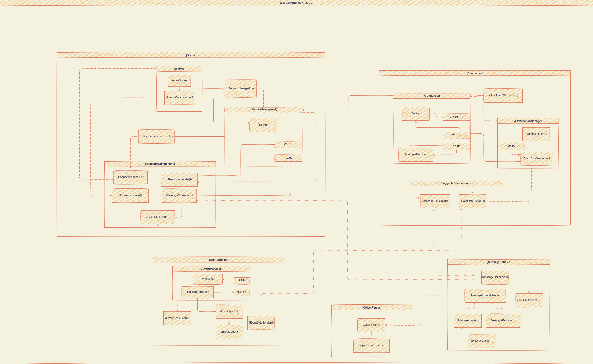

# JavaServerClientAPI (JSC)

[](https://github.com/pj-25/JavaServerClientAPI/actions/workflows/build.yml) · [JavaDocs](https://pj-25.github.io/JavaServerClientAPI/docs)

JSC is a small, dependency-free Java library for building TCP client/server applications around **events and typed messages** instead of raw sockets. I wrote it in June 2021, as a student, so my multiplayer Java projects could share one networking layer. Its first real consumer was **[Gameholic](https://github.com/pj-25/Gameholic)**, a platform for building and sharing multiplayer games.

> **Status:** historical project, kept for reference. It was built in 2021 on Java 8 and is not maintained as a production library. The build and tests were restored in 2026 so the code can be run and read. The design is unchanged.

## The problem
Every networked app I wrote, whether a chat app, a game lobby or a file transfer, repeated the same plumbing:
- accept connections and give each client its own handler;
- frame messages;
- tell *what kind* of message arrived;
- notify interested parts of the app when something happened, such as a connection, a close or an entity update.

JSC pulls that plumbing out once.

## Design


| Package | Responsibility |
|---|---|
| `jConnection` | `JConnection` wraps a socket. It owns a reader thread that hands each message to a `JMessageConsumer` (a lambda), and it can **pause and resume** reading so the socket can be temporarily handed to a different consumer, for example during a file transfer. |
| `jServer` | `JServer` runs an accept loop with **one thread per client**. Each client gets a fresh instance of your `JRequestManager` subclass, created by reflection, so per-connection state needs no locking. |
| `jMessageHandler` | Encodes and decodes a small text protocol: `TYPE / data`, `TYPE ~ EVENT > data`, attributes split by `;` and lists by `,`. |
| `jEventManager` | An observer-style event bus keyed by numeric event codes (`CONNECT`, `CLOSE`, `ENTITY_TRANSFER`, `UPDATED`, …). |
| `jObjectParser` | Lets domain objects serialise to and from the attribute format, so lists of entities can be sent in one message. |

Messages are framed with `DataOutputStream.writeUTF`, which writes a 2-byte length prefix followed by modified UTF-8.

### Trade-offs I made, and what I'd do differently now
- **Thread per connection.** Simple and correct for tens of game clients, but it doesn't scale to thousands. Today I'd use NIO, Netty or virtual threads (Java 21).
- **Human-readable delimiter protocol.** Easy to debug with `telnet`. But **delimiters are not escaped**, so data containing `/ ~ > ; ,` can be decoded wrongly. The transport is safe (it is length-prefixed and covered by a test); the problem is in field decoding. Today I'd use length-prefixed binary or JSON, with a versioned envelope.
- **`writeUTF` framing.** Each message is limited to 64 KB.
- **Pause and resume reading** checks the pause flag *before* each blocking read. A read already in flight can therefore still deliver one message after `setReadInterrupt(true)`. The behaviour is pinned down by `EchoRoundTripTest`.
- **Concurrency hygiene.** The connection flags aren't `volatile`, and `write()` isn't synchronised across threads that write at the same time. Both are fine for the original single-writer use, and both would be the first fixes in a v2.
- No TLS, authentication or back-pressure.

## Run it
You need JDK 17+ and Maven. The code targets Java 8.
```sh
mvn -f JSC/pom.xml test        # builds JConnection, then JSERVER; runs the end-to-end echo tests
```
`EchoRoundTripTest` starts a real `JServer` on an ephemeral port, connects a real `JConnection`, and checks:
- messages are echoed in order, including ones that contain delimiters and non-ASCII characters;
- pause and resume behave as described above.

### Minimal echo server and client
```java
public class Echo extends JRequestManager {            // one instance per connected client
    @Override public void accept(String req) { write(req); }
}
new JServer(5656, Echo.class).start();                  // blocks; one thread per client

JConnection c = new JConnection("127.0.0.1", 5656, System.out::println);
c.run();                                                // background reader thread
c.write("Hello, server!");
```
Larger examples are in `JSC/JSERVER/src/test/java` (`EchoServer`) and `JSC/JConnection/src/test/java` (`TestRelayEchoClient`).

## Repository layout
```
JSC/JConnection   connection, message and event library (Maven module)
JSC/JSERVER       server and per-client request managers (depends on JConnection)
JSC/libs          prebuilt jars from 2021
sourceCode/       flat copy of the library sources (added 2021-06-19; identical to JSC/)
docs/             generated JavaDocs (GitHub Pages)
```

## History
- 2021-06-10: initial implementation.
- 2021-06-11: JavaDocs.
- 2021-06 → 2021-11: used by Gameholic.
- 2026: Maven build repaired (duplicate JUnit dependency; the JSERVER → JConnection dependency had only been declared in the IDE); end-to-end tests and CI added.
